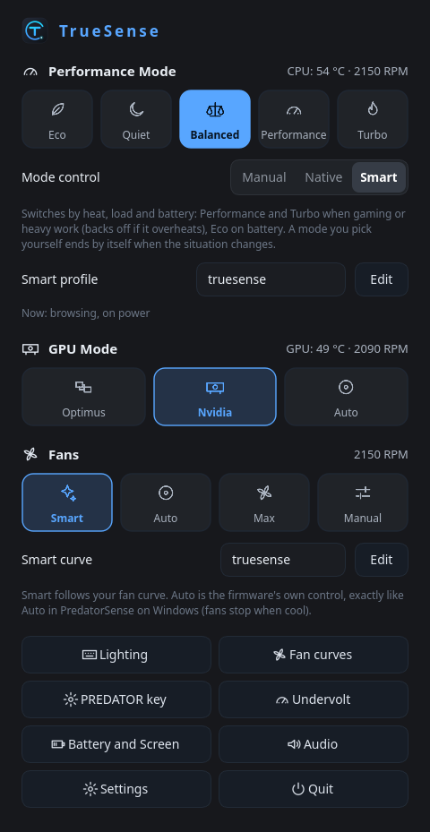
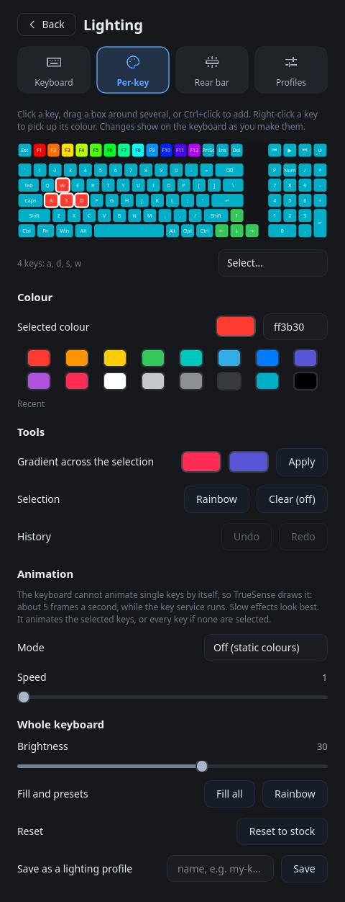
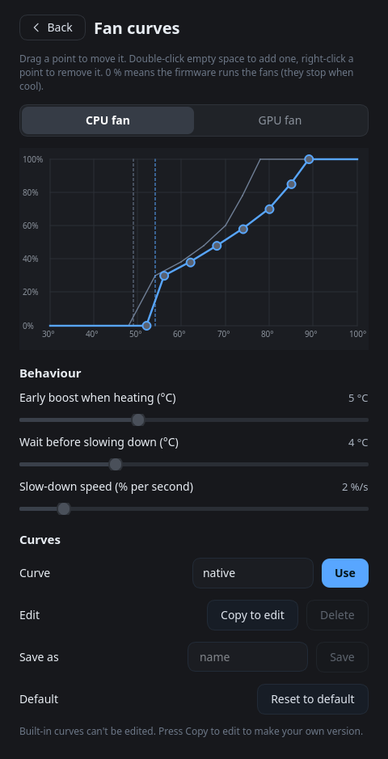
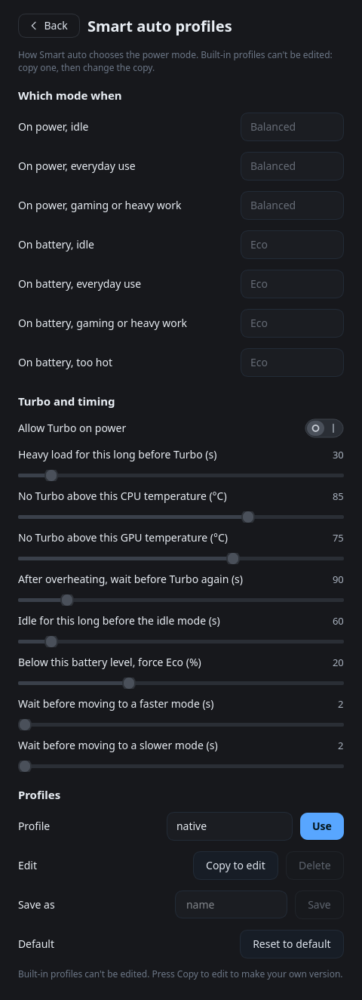
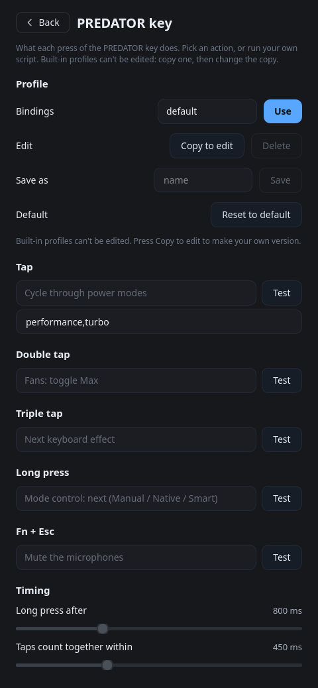
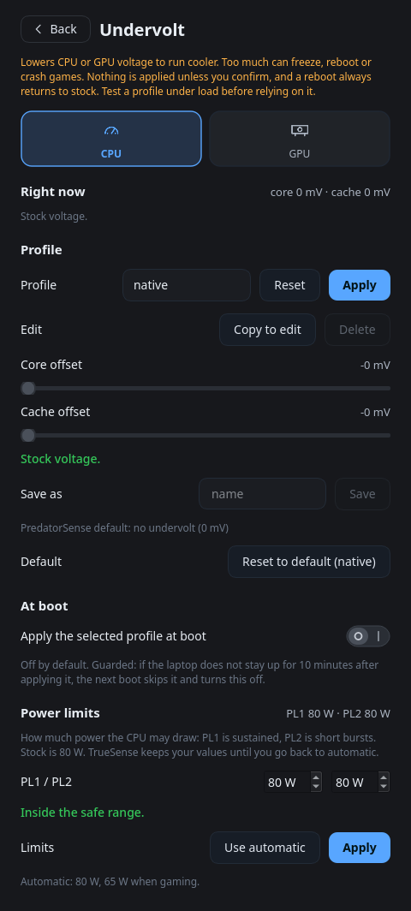
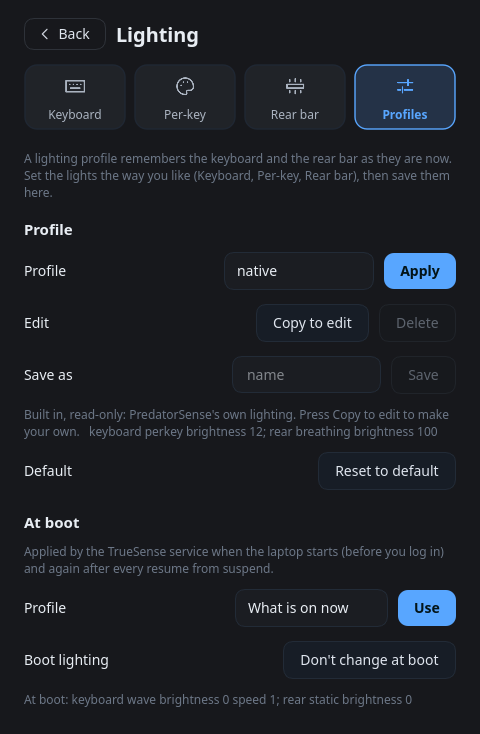
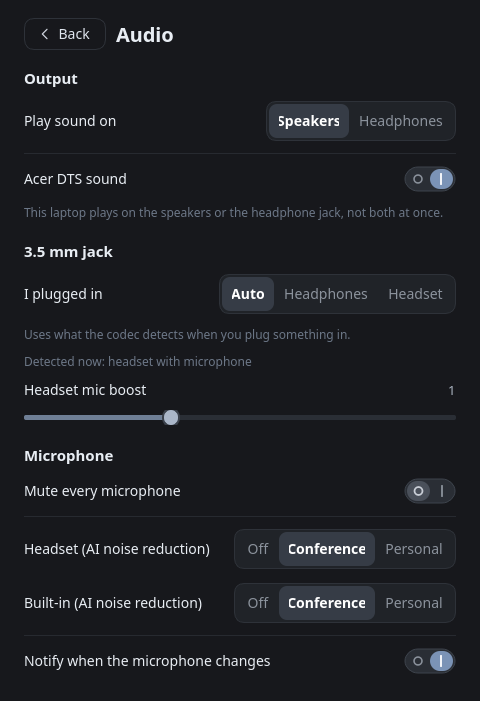

<p align="center"></p>

<h1 align="center">TrueSense for the Acer Predator Helios 16 (PH16-71)</h1>

<p align="center">
  <a href="https://github.com/Order52/truesense/actions/workflows/ci.yml"></a>
  <a href="LICENSE"></a>
  
  
  
  
</p>

**Hardware control for the Acer Predator Helios 16 (PH16-71) on Linux.**
Power modes, fans, GPU mode, battery, the rear light bar, per-key keyboard RGB, the PREDATOR key, audio extras, and CPU/GPU undervolting: one kernel module, one root service, one command line that does everything, and a small optional window.

<p align="center">
  
  
  
</p>

> **Hardware warning.** TrueSense was built and tested on one machine: **Acer Predator Helios 16 PH16-71, BIOS V1.18** (i7-13700HX, RTX 4060 Laptop, ALC245 audio, keyboard `04F2:0117`). It talks to the firmware (ACPI-WMI) and the keyboard controller. The kernel module refuses to load on other models unless forced, and forcing it on other hardware is at your own risk. Not affiliated with or endorsed by Acer (see [docs/LEGAL.md](docs/LEGAL.md)). Read [docs/SAFETY.md](docs/SAFETY.md) before you touch voltages or turn fans off.

## Contents
[Install](#install) · [A first look](#a-first-look) · [Features](#features) · [Safe by default](#safe-by-default) · [Command line](#command-line) · [How it works](#how-it-works) · [Status](#status) · [Documentation](#documentation) · [Credits and licence](#credits-and-licence)

## Install

**One line** (any supported distribution; it installs what is missing, builds the module, starts the service, then runs the checker):

```
curl -fsSL https://raw.githubusercontent.com/Order52/truesense/main/tools/get.sh | sudo bash
```

The download is checked against the release's `SHA256SUMS` before anything runs as root (releases from 0.3.16 are built by CI with signed provenance: `gh attestation verify`). **Update** the same way: the window's Update button, `sudo truesense update apply`, or the line above again; a failed update rolls back by itself. **Something stopped?** `truesense service check`, then `truesense service repair`.

**From a clone**, or to look first: `git clone https://github.com/Order52/truesense && cd truesense && tools/install.sh --check` (read-only report), then `sudo tools/install.sh`.
**Arch / CachyOS / Manjaro (AUR):** `yay -S truesense` once the package is published (see [docs/INSTALL.md](docs/INSTALL.md)); until then `cd packaging/arch && makepkg -si`.

```
truesense doctor          # checks everything and says how to fix what is wrong
truesense gui             # the window
truesense service check   # every unit, the module and the socket; `service repair` fixes what is down
truesense probe           # read-only report of this laptop (for support of similar models)
truesense tui             # the same, in the terminal (keyboard and mouse; nothing to install)
```

The installer detects Arch, Debian/Ubuntu, Fedora and openSUSE families, installs the prerequisites (dkms, compiler, kernel headers, Python, socat, the window's Qt) with the system package manager, test-builds the kernel module before touching anything, swaps the program files atomically and rolls back if the service does not start. Options, offline install, uninstall and per-distribution notes: [docs/INSTALL.md](docs/INSTALL.md). Only Arch/CachyOS has been tested on real hardware; the other families are covered by unit tests of the detection logic only (see [docs/STATUS.md](docs/STATUS.md)).

## A first look

A fresh install behaves like PredatorSense on Windows: the fans are on the firmware's own control, the power mode follows the power source, and nothing of ours touches clocks or power limits until you choose a smart feature. Every kind of profile has a built-in, read-only **`native`** entry that is exactly that default; copy a profile to make your own.

| | |
|---|---|
| <br>**Home**: power mode with Manual / Native / Smart control, GPU mode, fans | <br>**Per-key colours** on the real keyboard layout, with gradients, undo and software animations |
| <br>**Fan curves**: drag the points; the built-in curves are read-only | <br>**Smart auto profiles**: how it picks the mode from load, heat and battery |
| <br>**PREDATOR key**: an action per gesture, run your own script with a file picker | <br>**Undervolt** (CPU and GPU) with safety zones, power limits, guarded boot apply |
| <br>**Lighting profiles**, applied at boot by the service | <br>**Audio**: output, 3.5 mm jack, Purified Voice noise reduction, DTS |

More pictures: [docs/images](docs/images). They are regenerated by `python3 tools/screenshots.py` against the built-in simulator, so they show no personal data.

## Features

- **Power**: Eco, Quiet, Balanced, Performance, Turbo. **Mode control**: Manual, **Native auto** (Balanced on power, Eco on battery, like PredatorSense) or **Smart auto** (Performance when you game, Turbo when that is sustained and cool enough, a back-off if it overheats, Eco on battery) with editable profiles. A mode you pick yourself ends by itself when the situation changes.
- **Fans**: firmware Auto (native), Smart curve (built-in and your own curves, drag-to-edit), Max, Manual with one slider or separate CPU and GPU sliders, and Off with a warning and a temperature watchdog.
- **GPU mode** (Optimus, NVIDIA only, Auto), **battery** (80 % limit, charge to 100 % once, calibration, USB charging while off), **LCD overdrive**, **boot sound**.
- **Lighting**: keyboard effects (13) with colour, speed and brightness; per-key RGB on a picture of the real keyboard (select, palette, gradient, rainbow, undo, animations); the rear light bar's three parts; saved lighting profiles applied at boot and after suspend.
- **PREDATOR key**: tap, double, triple, long press and Fn+Esc, each bound to any action, including your own script. Profiles for the bindings.
- **Undervolt**: CPU (core and cache) and GPU (clock curve and cap) profiles, power limits, safety zones, typed confirmation beyond the danger line, reset to stock, and a crash-guarded apply at boot.
- **Audio**: speakers and headphones switching, the 3.5 mm jack mode, headset microphone boost, Purified Voice style AI noise reduction, Acer DTS through AcerUltraX.
- **Updates**: `truesense update check` / `apply`, an Update button and banner in the window, and an optional daily check (off until you switch it on) that notifies you when a new release is out.
- **Automation and tools**: a root service with a watchdog, the Fn-key service, a doctor, a self-test, shell completions, JSON output everywhere, Noctalia bar widgets, a fast path for status bars.

## Safe by default

- Every write is **read, write, read back**; fans return to the firmware on exit, crash or service stop; the kernel module validates every value and hands the fans back when it unloads.
- **Voltages never apply without confirmation**, a reboot always returns to stock, beyond the *danger line* you must type `APPLY` (window) or pass `--force` (CLI), and the apply-at-boot option disables itself if the previous boot did not stay up 10 minutes.
- **Fans off** only starts when cool and the service gives the fans back to the firmware if it gets warm.
- No firmware flashing, no boot-logo writes, no EC access outside the documented WMI calls.
- The control socket checks the caller's user id; the service is sandboxed by systemd.

Details, limits and how to recover from a bad setting: [docs/SAFETY.md](docs/SAFETY.md).

## Command line

```
truesense status                          everything at a glance
truesense power set turbo                 eco quiet balanced performance turbo
truesense power auto smart                off | native | smart
truesense fan curve use quiet             fan curves; copy a built-in to edit it
truesense fan set 60 80                   manual duty: CPU 60 %, GPU 80 %
truesense battery full start              charge to 100 % once
truesense keyboard effect wave --speed 4  per-key: keyboard paint w=ff0000 arrows=00ff00
truesense look save my-lights             a lighting profile; truesense startup boot my-lights
truesense keys profile use gaming         PREDATOR key profiles
truesense cpu undervolt list              use NAME --confirm | reset | boot NAME --confirm
truesense doctor                          check the whole stack
```

Every area takes `on|off|toggle|status` where that makes sense, and `--json` anywhere. The full reference is [docs/USAGE.md](docs/USAGE.md).

## How it works

```
firmware (ACPI-WMI) <- truesense_wmi (DKMS kernel module, /dev/truesense)
                              ^
      truesense service (root, systemd, watchdog)  <- JSON socket ->  CLI, window, key service, status bars
      fans, power modes, smart auto, power limits, undervolt, boot lighting, saved state
      user services: truesense-keys (PREDATOR/Fn keys, key animations), truesense-audio, truesense-startup
```

See [docs/ARCHITECTURE.md](docs/ARCHITECTURE.md). The simulator (`TRUESENSE_SIM=1`) runs everything without hardware and `make test` runs the test suite.

## Status

Verified on the real laptop, partly verified, and not yet verified features are listed honestly in [docs/STATUS.md](docs/STATUS.md). Short version: the firmware settings, fans, lighting, keys and audio were verified on hardware; Smart auto, fan-off, charge-to-full-once, undervolt writes and the key animations are covered by simulator tests but have **not** been exercised on the real laptop yet.

## Documentation

[USAGE](docs/USAGE.md) · [SAFETY](docs/SAFETY.md) · [ARCHITECTURE](docs/ARCHITECTURE.md) · [PERFORMANCE](docs/PERFORMANCE.md) · [TROUBLESHOOTING](docs/TROUBLESHOOTING.md) · [STATUS](docs/STATUS.md) · [LEGAL](docs/LEGAL.md) · [CREDITS](docs/CREDITS.md) · [CONTRIBUTING](CONTRIBUTING.md) · [CODE OF CONDUCT](CODE_OF_CONDUCT.md) · [SECURITY](SECURITY.md) · [Release notes](RELEASE_NOTES.md) · hardware interface notes in [PROTOCOL](docs/PROTOCOL.md) and measurements in [docs/hardware-data](docs/hardware-data)

## Credits and licence

TrueSense is **MIT licensed** ([LICENSE](LICENSE); the kernel module is dual MIT / GPL-2.0-only) and exists because of other people's work. Full credits, with what each project gave us and its licence, are in [docs/CREDITS.md](docs/CREDITS.md):

- [**Linuwu-Sense**](https://github.com/0x7375646F/Linuwu-Sense): the map of the Acer WMI interface for Linux, checked on the real laptop.
- [**AcerUltraX**](https://github.com/fawaz7/AcerUltraX): Acer DTS sound on Linux.
- [**RNNoise**](https://github.com/xiph/rnnoise) and [**noise-suppression-for-voice**](https://github.com/werman/noise-suppression-for-voice): the microphone noise reduction.
- [**G-Helper**](https://github.com/seerge/g-helper) and [**PreySense**](https://github.com/hammadzaigham/PreySense): the design ideas behind the window and the safety model.
- The maintainer's earlier tools [ph16-71-rgb](https://github.com/Order52/ph16-71-rgb), [Predator-Key](https://github.com/Order52/Predator-Key) and [linuwu-sense-cli](https://github.com/Order52/linuwu-sense-cli), which this project replaces.

No Acer, DTS or Realtek files are included. "Acer", "Predator" and "PredatorSense" are trademarks of Acer Inc., used only to describe compatibility; TrueSense is not affiliated with or endorsed by Acer. What is and is not in this repository, and the licences of what you install alongside it, are in [docs/LEGAL.md](docs/LEGAL.md). "PredatorSense" and "Predator" are trademarks of Acer Inc.; they are used only to describe compatibility.
